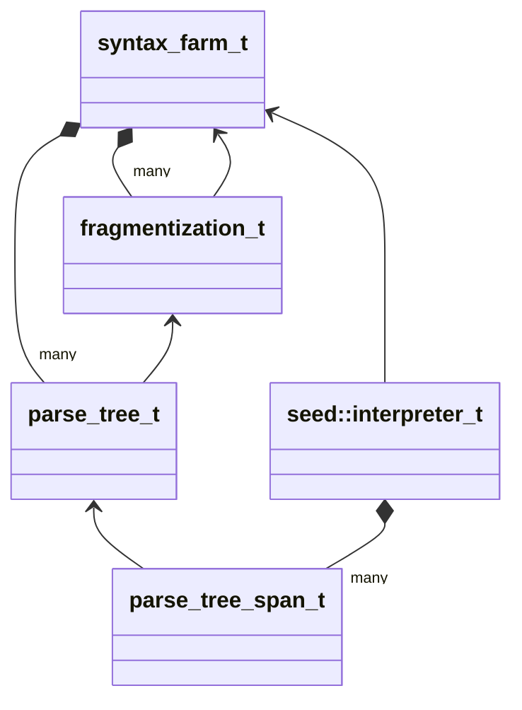

# Syntax Module

## Fragmentization

Fragmentization is the first step that is applied to every input file of Silva. Fragmentization is a
bit like tokenization/lexing in other languages, although more fine-grained: fragments in Silva are
almost always shorter than tokens in other languages or equally long.

[fragmentization.hpp](fragmentization.hpp)

All input files are assumed to be encoded in UTF-8. For the most part, all that fragmentization does
is break the input up into Unicode codepoints. Fragmentization also does a few additional things,
though:
* Recognize indentation and sub-languages.
* Recognize multiline strings.
* Recognize line continuations.
* Categorize Unicode codepoints.

The output/result of fragmentization is an array of "fragments". Every fragment has a category based
on the enum `fragment_category_t`. The `silva_fragmentization` tool can be used on a file to see
what fragments Silva produces for this file.

```
build/src/silva_fragmentization src/syntax/readme.fragmentization.demo
```

Sub-languages can be introduced in two ways. The first way is by using the parenthesis characters
'«' '»'. These two characters have a strong, special meaning in Silva; they even retain their
meaning in most strings and comments. It's also possible to introduce a sub-language via the
character '⎢'. With this approach everything on the same line to the right is considered to be a
sub-language and consecutive lines which also have this character are considered to also belong to
that sub-language. This is a bit similar to multiline string literals in Zig. In Silva, such
multiline literals are also supported, but via the character '¶'.

Indentation is handled similarly to Python, with INDENT and DEDENT fragments being emitted whenever
the indentation level increases or decreases. In order to also support free-form languages (like C),
though, there exists an additional INDENTATION_BROKEN fragment, which is emitted if a lower
indentation level was encountered that was not previously encountered; once this is emitted, no more
INDENT/DEDENT fragments will be emitted for the rest of the processed language.

Also a NEWLINE fragment is emitted at the end of every line that does not use line continuation
('\\' character at the end). Unlike in Python, NEWLINE fragments are not omitted inside parentheses.

All other fragments correspond one-to-one to Unicode codepoints. Such fragments are called "simple",
and they have one of the following categories:
* SPACE: ASCII 0x20 ' '
* DIGIT: '0' to '9'
* PARENTHESIS: operator that has a matching open/close operator, e.g., '{' '}'
* OPERATOR: e.g., '*'
* ID_LOWER: Unicode General Category = Ll
* ID_UPPER: Unicode General Category = Lu
* ID_START: Unicode Derived Property: XID_Start (including ID_LOWER, ID_UPPER)
* ID_CONTINUE: Unicode Derived Property: XID_Continue (including ID_START and DIGIT)

Any other Unicode code-point not explicitly allowed as above, or any sequence that's not in NFC,
means that the input file is considered to be ill-formed.

One of the core ideas behind the design of the fragmentization is that a language should be able to
determine the name of a used sub-language from its own type system, without that name being
explicitly mentioned in the text. For this it was necessary to make all languages share the same
fragmentization. The fragmentization is the common denominator between all languages in Silva.

## Tokens and Names

Tokens and names are both represented by integers in Silva via the value-types `token_id_t` and
`name_id_t`. The struct `syntax_farm_t` maintains the mapping from token-id and name-id to the
strings represented by them.

[syntax_farm.hpp](syntax_farm.hpp)

A "token" can be thought of as an interned string. The syntax-farm contains an array of
`token_info_t` values, and a token-id is an index into that array.

A "name" is effectively a sequence of tokens. To represent a name as a single integer, the
syntax-farm contains an array of `name_info_t` values (again indexed by the name-id) each of which
stores a single token (called the "basename", analogous to the Linux command `basename`) and a
parent name-id. To determine the full name from a name-id, one has to follow the parent names until
an empty parent name is encountered (singly-linked list). Then one has to concatenate all the
encountered basenames in reverse order to obtain the full name.

## The Seed Language

The Seed language provides a way to succinctly define parsing functions that call each other. A
parsing function is a function that turns a fragmentization into a parse-tree. A parse-tree here is
a very specific data-type, which is described by the types `parse_tree_t` or more commonly
`parse_tree_span_t`.

[parse_tree.hpp](parse_tree.hpp)

In short, a parse-tree is a contiguous array or span of nodes with the nodes stored in pre-order.
The tree structure is maintained by two integers (`num_children` and `subtree_size`) in each node.
Furthermore, each node stores some semantic information (a rule-name, the fragment-range that it
corresponds to, and whether this node is understood to represent a token via the `allow_token`
member).

The parse-tree data-structure is meant to be built into Silva as a fundamental data type, with
various language features allowing to construct, modify, and inspect such parse-tree directly. It
should be possible to define literals that are parse-trees (by using a sub-language). Silva
variables can hold parse-trees. Silva functions can take and return parse-trees. Parse-trees are
first-class objects in every sense.

Seed is basically a PEG parser (greedy repetition, ordered choice, but with a few twists, see below)
with an integrated shunting-yard mechanism for parsing [a]rithmetic e[x]pr[e]ssions (called Axe).
Since the input to a Seed program is a fragmentization, though, Seed also handles tokenization
within the PEG idiom. For this, Seed defines two types of rules: branch-rules (normal, grammatical
PEG rules) and twig-rules (basically tokenization rules). A branch-rule is identified by the
basename of the rule's name being in PascalCase whereas a twig-rule is in camelCase. Both types of
rules (if successfully parsed) create nodes in the resulting parse_tree_t (unless they use the
"no_node" qualifier).

[seed.hpp](seed.hpp)

The Seed language is defined in itself in the previous link. For bootstrapping purposes a
hand-written Seed parser is also implemented here.

Here is a simple Seed parser for the toy language "Fern", which is a bit like JSON, but much
simpler.

To give a first example, here is a simple Seed parser for basic arithmetic expressions, including
variables, called `Calc`.

```
build/src/silva_syntax src/syntax/readme.calc.seed src/syntax/readme.calc
```

Seed allows languages to define a so-called "skip" rule to skip whitespace. The skip-rule is invoked
at the very beginning of a parse (more precisely the `skip.initial` rule, but falls back to the
normal skip rule `skip.@` if it doesn't exist), and then also every time after a *branch-rule*
successfully applied a *twig-rule* (but a twig-rule successfully applying another twig-rule or a
branch-rule successfully applying another branch-rule does *not* trigger the skip-rule); in this
case, the twig-rule will *not* contain the fragments that were skipped while the branch-rule *will*
contain them. The skip-rule is also invoked after every time a branch-rule uses a literal (literals
are treated as mini-twig-rules).

Usually, branch-rules will call branch-rules and twig-rules, but in most cases, twig-rules will only
call other twig-rules. This is because twig-rules represent tokenization (through their interaction
with the skip-rule) and tokens usually don't contain nested semantic constructs. An exception to
this is a construct like Python's f-strings. While the string part of an f-string is a token, the
nested expressions are proper code and need to skip whitespace again. For this reason, if a
twig-rule successfully applied a branch-rule (e.g., when the parser is just after the '}' in «
f"Hello { x } World" »), and skipped some whitespace (here the " " just before "World"), this
whitespace needs to be unskipped, so that the second part of the f-string is " World" and not just
"World".

A node derived from a twig-rule allows a token to be derived, i.e., the `allow_token` member is
true. It is not allowed to derive tokens from branch-rules.

Only twig-rules may directly refer to fragments via their ALL_CAPS fragment category name. Like
branch-rules, twig-rules may also use string literals. Two additional ALL_CAPS identifiers exist:
"ANY" matches any single visible fragment (silva::is_fragment_category_visible(); this is any
fragment except indentation related tokens, NEWLINE, and LINE_CONTINUATION), and "LANGUAGE" which
matches a whole balanced LANG_BEGIN/LANG_END region.

The parsing functions in Seed are called rules because they look similar to the rules in BNF.
Eventually, a Seed rule is really just a function, though, that takes an implicit argument, which is
a pointer to a `parse_tree_nursery_t`. Using another rule on the right-hand-side of a rule
(non-terminal), is the equivalent of a function call to that function. Once Silva is more mature, it
should also be possible to hand-write custom parsing functions that don't exactly fit the Seed/PEG
idiom.

The rule name '@' has a special meaning, which is to identify the main entrypoint/rule for a scope.
Then, if a scope name is used on the right-hand-side of a rule, this is resolved to the '@' rule of
that scope. Whether the rule is treated as a branch-rule or twig-rule then depends on the
capitalization of the scope's basename.

In Seed, there is a subtle distinction between literals that use double-quotes (") and those that
use single-quotes ('). With single-quotes, it simply tries to match the code-points in the literal
one by one. With double-quotes it does that, too, but then also checks that the codepoint following
the last matched codepoint (if it exists) is NOT text (i.e., not
silva::is_fragment_category_id_continue()). So, the literal "language" doesn't match the beginning
of « language_name » but 'language' does. Both types of literal (single and double quoted) do not
generate nodes in the resulting parse-tree by default; the "literal_nodes" qualifier can be
specified, though, to change this.

### The prefix directive and the commit operator

Often an initial keyword signals the beginning of a specific grammatical construct. For
example, every function might begin with "fun". In this case, Seed allows the parser to
"commit", meaning that, here in this example, a valid function is expected to be parsed after
"fun" or the entire parse is considered to be failed.

Committing behaviour can be triggered in two ways: via the prefix directive or by explicitly using
the commit operator ('~'). Both approaches work on the level of a .Seed.Expr.Concat (concatenated)
expression. The prefix directive says that if a concatenated expression starts with at least one
literal, the parser commits if all leading literals are matched; this is as-if the commit operator
is put after a consecutive streak of leading literals.

For example, if the Seed rule
   ⎢ ConstFunc = "static" "func" ~ identifier | "static" identifier number
is used to parse the language
   ⎢ static func 42
this will result in a parse error even though the second alternative would be a match. This is
because all leading literals (the "prefix") in the first alternative (of which there are two:
"static" and "func") are already matched (there is also a gratuitous commit operator). So at
that point, the parsing algorithm commits to the first alternative and aborts the entire parse
if the whole *first concatenated expression* does not match. On the other hand, if the same
Seed rule is used to parse
   ⎢ static class 42
this works just fine, as the parser never got to the commit point.

To disable the prefix directive for a concatenated expression, use the epsilon production. So,
the rule
   ⎢ ConstFunc = ε "static" "func" identifier | "static" identifier number
parses « static func 42 » just fine.

### Axe

Expressions are parsed with a variant of the Shunting Yard algorithm.

[seed_axe.hpp](seed_axe.hpp)

You basically specify a number of operators, in the order of their desired precedence (from high
precedence to low precedence), what type of operator they are (prefix, infix, left-to-right,
right-to-left, nested, ...), and what an atom looks like. From this description an expression parser
is then generated. For example,

«
Expr = axe number
  Prefix   = rtl   prefix '-'
  Product  = ltr   infix '*' '/'
  Addition = ltr   infix '+' '-'
»

can be used to parse

« 1 + 2 * 3 + - 4 »

in the normal, mathematical way.

### Various final thoughts

Some Seed global definitions are defined in the following file.

[seed.globals.hpp](seed.globals.hpp)

This file contains some standard definitions like `indent`, `dedent`, `newline`, `none`, and
`number`. It also contains the two skip-rules `offSide` and `freeForm`. Unfortunately, the `offSide`
skip rule is intertwined with the comment style, so using the `offSide` skip rule with a different
comment style would currently require a lot of duplication; this is meant to be addressed via
parameterizable functions (higher-order functions) at some point.

The fragmentization treats some Unicode code-points special: '⎢', '«', '»', '¶' and a '\\' at the
end of a line. Because comments and single-line strings are handled directly inside Seed and not as
part of the tokenization, these characters keep their meaning inside comments and strings. In
particular a '«' inside a comment must still be matched by a '»' inside the same comment.

Comments are code as far as the off-side rule is concerned: they take part in indentation and a
mis-indented comment leads to an INDENTATION_BROKEN fragment.

## Topological Order of Dependency Graph of Header Files

* [syntax_farm.hpp](syntax_farm.hpp)
* [fragmentization_data.hpp](fragmentization_data.hpp) (generated)
* [fragmentization.hpp](fragmentization.hpp)
* [parse_tree.hpp](parse_tree.hpp)
* [parse_tree_nursery.hpp](parse_tree_nursery.hpp)
* [seed.lexicon.hpp](seed.lexicon.hpp)
* [seed_axe.hpp](seed_axe.hpp)
* [seed.hpp](seed.hpp)
* [seed_interpreter.hpp](seed_interpreter.hpp)
* [syntax.hpp](syntax.hpp)



## References

* The quite readable original paper by Bryan Ford [Parsing Expression Grammars: A Recognition-Based
  Syntactic Foundation](https://bford.info/pub/lang/peg.pdf)
* Guido van Rossum's [PEG Parsing
  Series](https://medium.com/@gvanrossum_83706/peg-parsing-series-de5d41b2ed60)
* Eli Bendersky's blog on [precedence
  climbing](https://eli.thegreenplace.net/2012/08/02/parsing-expressions-by-precedence-climbing).
